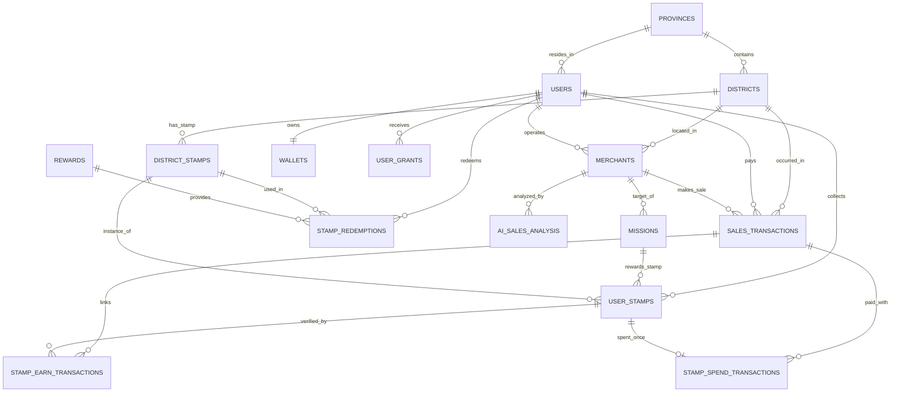

# 🗄️ ข้อกำหนดโครงสร้างฐานข้อมูลและโมเดลข้อมูล (Database Architecture & Data Dictionary)
### โครงการ ไทยช่วยไทยพลีส (Thai Chuay Thai Please / Kai-Chauy-Roi)

---

## 1. ข้อมูลเทคนิคของระบบฐานข้อมูล (Database Engine Overview)

* **Database Engine**: MySQL 8.x
* **Default Database Name**: `thai_chuay_thai_please`
* **Character Set & Collation**: `utf8mb4` / `utf8mb4_unicode_ci` (รองรับภาษาไทยเต็มรูปแบบและ Emojis)
* **Object-Relational Mapping (ORM)**: Prisma ORM 6.x
* **Prisma Schema File**: [`backend/prisma/schema.prisma`](file:///c:/Users/thana/uni/year4_semester1/web_apps/kai-chauy-roi--projectWebapp/backend/prisma/schema.prisma)
* **Database Backup/DDL File**: [`backend/database.sql`](file:///c:/Users/thana/uni/year4_semester1/web_apps/kai-chauy-roi--projectWebapp/backend/database.sql)

---

## 2. แผนภาพความสัมพันธ์ของข้อมูล (Entity-Relationship Diagram - ERD)



---

## 3. พจนานุกรมข้อมูลอย่างละเอียด (Data Dictionary)

### 3.1 กลุ่มข้อมูลภูมิศาสตร์ (Geographical Data)

#### 1) ตาราง `provinces` (ข้อมูลจังหวัด)
| คอลัมน์ | ชนิดข้อมูล | เงื่อนไข | คำอธิบาย |
| :--- | :--- | :---: | :--- |
| `Prov_ID` | `INT` | PK, Auto Inc | รหัสประจำจังหวัด |
| `Prov_Name` | `VARCHAR(100)` | Not Null | ชื่อจังหวัด (ภาษาไทย) |

#### 2) ตาราง `districts` (ข้อมูลอำเภอ/เขต)
| คอลัมน์ | ชนิดข้อมูล | เงื่อนไข | คำอธิบาย |
| :--- | :--- | :---: | :--- |
| `Dist_ID` | `INT` | PK, Auto Inc | รหัสประจำอำเภอ/เขต |
| `Dist_Name` | `VARCHAR(100)` | Not Null | ชื่ออำเภอ/เขต |
| `Prov_ID` | `INT` | FK -> `provinces(Prov_ID)` | รหัสจังหวัดต้นสังกัด |
| `Stamp_Min_Spend` | `DECIMAL(12,2)` | Default `150.00` | ยอดซื้อรวมขั้นต่ำต่อบิลเพื่อรับแสตมป์ประจำอำเภอ |
| `Stamp_Reward_Count` | `INT` | Default `1` | จำนวนแสตมป์ที่ได้รับต่อบิลที่ถึงเกณฑ์ (ตั้งค่าได้ 1–100 ดวง) |

---

### 3.2 กลุ่มข้อมูลผู้ใช้งานและกระเป๋าเงิน (User & Financial Accounts)

#### 3) ตาราง `users` (บัญชีผู้ใช้งาน)
| คอลัมน์ | ชนิดข้อมูล | เงื่อนไข | คำอธิบาย |
| :--- | :--- | :---: | :--- |
| `User_ID` | `INT` | PK, Auto Inc | รหัสผู้ใช้งาน |
| `Citizen_ID` | `VARCHAR(20)` | Unique, Not Null | เลขประจำตัวประชาชน 13 หลัก |
| `Phone` | `VARCHAR(15)` | Unique, Not Null | หมายเลขโทรศัพท์มือถือ |
| `Name` | `VARCHAR(200)` | Nullable | ชื่อผู้ใช้งาน |
| `Pin_Hash` | `VARCHAR(255)` | Nullable | hash ของ PIN ตัวเลข 6 หลัก ไม่เก็บ PIN ดิบ |
| `Password` | `VARCHAR(255)` | Not Null | รหัสผ่าน (Hashed หรือข้อความที่ปลอดภัย) |
| `Role` | `VARCHAR(20)` | Default `"USER"` | บทบาทผู้ใช้งาน (`USER`, `MERCHANT`, `ADMIN`) |
| `Province_ID` | `INT` | FK -> `provinces(Prov_ID)`, Nullable | จังหวัดที่พำนักอาศัย |
| `Is_Suspended` | `BOOLEAN` | Not Null, Default `false` | ระงับทั้งบัญชีผู้ใช้และร้านทั้งหมดที่เชื่อมผ่าน `User_ID` |

#### 4) ตาราง `wallets` (กระเป๋าเงินดิจิทัล)
| คอลัมน์ | ชนิดข้อมูล | เงื่อนไข | คำอธิบาย |
| :--- | :--- | :---: | :--- |
| `Wallet_ID` | `INT` | PK, Auto Inc | รหัสกระเป๋าเงิน |
| `User_ID` | `INT` | Unique, FK -> `users(User_ID)`, Nullable | เจ้าของกระเป๋าผู้ใช้ |
| `Merchant_ID` | `INT` | Unique, FK -> `merchants(Mch_ID)`, Nullable | เจ้าของกระเป๋าร้านค้า (API กำหนดอย่างใดอย่างหนึ่งกับ `User_ID`) |
| `Balance` | `DECIMAL(12,2)` | Default `0.00` | ยอดเงินคงเหลือในกระเป๋า |
| `Status` | `VARCHAR(30)` | Default `"ACTIVE"` | สถานะกระเป๋าเงิน |
| `Updated_At` | `DATETIME` | Auto Update | วันเวลาที่อัปเดตยอดล่าสุด |

#### 5) ตาราง `user_grants` (สิทธิ์เงินอุดหนุนภาครัฐของผู้ใช้)
| คอลัมน์ | ชนิดข้อมูล | เงื่อนไข | คำอธิบาย |
| :--- | :--- | :---: | :--- |
| `Grant_ID` | `BIGINT` | PK, Auto Inc | รหัสสิทธิ์เงินอุดหนุน |
| `User_ID` | `INT` | FK -> `users(User_ID)` | รหัสผู้ได้รับสิทธิ์ |
| `Grant_Name` | `VARCHAR(200)` | Nullable | ชื่อโครงการอุดหนุน (เช่น "ไทยช่วยไทย") |
| `Total_Grant_Amount` | `DECIMAL(12,2)` | Default `1000.00` | วงเงินเริ่มต้นที่ได้รับ (1,000 บาท) |
| `Remaining_Amount` | `DECIMAL(12,2)` | Not Null | วงเงินช่วยเหลือคงเหลือที่ยังใช้ได้ |
| `Granted_At` | `DATETIME` | Default `now()` | วันเวลาที่ได้รับสิทธิ์ |
| `Status` | `VARCHAR(30)` | Default `"ACTIVE"` | สถานะสิทธิ์ (`ACTIVE`, `EXPIRED`, `EXHAUSTED`) |

#### 5.1) ตาราง `grant_policy` (นโยบายอัตราการร่วมจ่ายกลางของภาครัฐ)
| คอลัมน์ | ชนิดข้อมูล | เงื่อนไข | คำอธิบาย |
| :--- | :--- | :---: | :--- |
| `Policy_ID` | `INT` | PK, Auto Inc | รหัสประวัตินโยบาย |
| `Gov_Pay_Ratio` | `DECIMAL(5,4)` | Default `0.4000` | สัดส่วนที่ภาครัฐช่วยจ่าย (เช่น 0.40 = 40%) |
| `User_Pay_Ratio` | `DECIMAL(5,4)` | Default `0.6000` | สัดส่วนที่ประชาชนต้องจ่าย (เช่น 0.60 = 60%) |
| `Grant_Amount` | `DECIMAL(12,2)` | Default `1000.00` | วงเงินมาตรฐานของโครงการ |
| `Effective_From` | `DATETIME` | Default `now()` | วันเวลาที่นโยบายมีผลบังคับใช้ |
| `Created_By` | `INT` | FK -> `users(User_ID)` | ผู้ดูแลระบบ (Admin) ที่บันทึกนโยบาย |
| `Note` | `VARCHAR(255)` | Nullable | บันทึกช่วยจำ / มติ ครม. |

---

### 3.3 กลุ่มข้อมูลร้านค้าและการซื้อขาย (Merchants & Transactions)

#### 6) ตาราง `merchants` (ข้อมูลร้านค้าชุมชน)
| คอลัมน์ | ชนิดข้อมูล | เงื่อนไข | คำอธิบาย |
| :--- | :--- | :---: | :--- |
| `Mch_ID` | `INT` | PK, Auto Inc | รหัสประจำร้านค้า |
| `User_ID` | `INT` | FK -> `users(User_ID)` | ผู้ใช้ที่เป็นเจ้าของร้านค้า |
| `Shop_Name` | `VARCHAR(200)` | Not Null | ชื่อร้านค้า |
| `Owner_Name` | `VARCHAR(200)` | Nullable | ชื่อเจ้าของหรือผู้ติดต่อร้าน |
| `Category` | `ENUM` | Nullable | อาหารและเครื่องดื่ม, ของใช้ทั่วไป, หัตถกรรม/ของฝาก, บริการชุมชน, ผลไม้/เกษตรแปรรูป, เสื้อผ้าและเครื่องแต่งกาย, สุขภาพและความงาม, บ้านและเครื่องใช้ |
| `Lat` | `DECIMAL(10,7)` | Nullable | พิกัดละติจูดของร้าน |
| `Lng` | `DECIMAL(10,7)` | Nullable | พิกัดลองจิจูดของร้าน |
| `Dist_ID` | `INT` | FK -> `districts(Dist_ID)` | รหัสอำเภอที่ร้านค้าตั้งอยู่ |

#### 7) ตาราง `sales_transactions` (ประวัติการชำระเงินและเงินอุดหนุน)
| คอลัมน์ | ชนิดข้อมูล | เงื่อนไข | คำอธิบาย |
| :--- | :--- | :---: | :--- |
| `Tx_ID` | `BIGINT` | PK, Auto Inc | รหัสธุรกรรมการซื้อขาย |
| `User_ID` | `INT` | FK -> `users(User_ID)` | รหัสผู้ซื้อสินค้า |
| `Merchant_ID` | `INT` | FK -> `merchants(Mch_ID)` | รหัสร้านค้าที่เกิดรายการ |
| `Total_Amount` | `DECIMAL(12,2)` | Not Null | ยอดเงินรวมทั้งสิ้นของบิล |
| `User_Paid_Amount` | `DECIMAL(12,2)` | Default `0.00` | ยอดเงินที่ตัดจากกระเป๋าผู้ใช้ |
| `Gov_Subsidized_Amount` | `DECIMAL(12,2)` | Default `0.00` | ยอดเงินที่ภาครัฐช่วยจ่ายตามนโยบาย |
| `Stamp_Paid_Amount` | `DECIMAL(12,2)` | Default `0.00` | ยอดที่จ่ายด้วยสแตมป์ (1 ดวง = 1 บาท) |
| `Tx_Timestamp` | `DATETIME` | Not Null | วันเวลาที่เกิดธุรกรรม |
| `District_ID` | `INT` | FK -> `districts(Dist_ID)` | อำเภอที่เกิดการซื้อขาย |
| `Status` | `VARCHAR(30)` | Not Null | สถานะธุรกรรม (`COMPLETED`, `CANCELLED`) |

---

### 3.4 กลุ่มข้อมูล AI วิเคราะห์ยอดขายและภารกิจ (AI & Missions)

#### 8) ตาราง `ai_sales_analysis` (ผลการวิเคราะห์ยอดขายด้วย AI)
| คอลัมน์ | ชนิดข้อมูล | เงื่อนไข | คำอธิบาย |
| :--- | :--- | :---: | :--- |
| `Analysis_ID` | `BIGINT` | PK, Auto Inc | รหัสผลการวิเคราะห์ |
| `Merchant_ID` | `INT` | FK -> `merchants(Mch_ID)` | รหัสร้านค้าที่ถูกวิเคราะห์ |
| `Sales_Amount` | `DECIMAL(12,2)` | Not Null | ยอดขายของบิลล่าสุด |
| `Average_Sales` | `DECIMAL(12,2)` | Not Null | ยอดขายเฉลี่ยต่อบิลของร้านค้า |
| `Sales_Ratio` | `DECIMAL(8,4)` | Nullable | อัตราส่วนยอดขายล่าสุดเทียบกับค่าเฉลี่ย |
| `Sales_Status` | `VARCHAR(30)` | Nullable | สถานะยอดขาย (`LOW`, `NORMAL`, `HIGH`) |
| `Boost_Recommended` | `BOOLEAN` | Default `false` | แนะนำให้กระตุ้นยอดขายหรือไม่ (`true` หาก Ratio < 0.8) |
| `Analyzed_At` | `DATETIME` | Not Null | วันเวลาที่ทำการประมวลผลวิเคราะห์ |

#### ตาราง `daily_mission_analyses` (ผลวิเคราะห์ภารกิจรายจังหวัด)
หนึ่งแถวต่อจังหวัดต่อวันที่วิเคราะห์ งานประมวลผลรันทุกวันเวลา 00:00 น. ตามเวลาไทย โดยใช้บิลของวันที่เพิ่งจบ

| คอลัมน์ | ชนิดข้อมูล | เงื่อนไข | คำอธิบาย |
| :--- | :--- | :---: | :--- |
| `Analysis_ID` | `INT` | PK, Auto Inc | รหัสผลวิเคราะห์ |
| `Analysis_Date` | `DATE` | Unique ร่วมกับ `Province_ID` | วันที่ของบิลตามเวลาไทย |
| `Province_ID` | `INT` | FK -> `provinces(Prov_ID)` | จังหวัด |
| `Merchant_ID` | `INT` | Nullable | รหัสร้านที่สุ่มได้ |
| `Shop_Name` | `VARCHAR(200)` | Nullable | ชื่อร้านขณะวิเคราะห์ |
| `Status` | `VARCHAR(30)` | Not Null | `PENDING`, `READY`, `NO_MERCHANT`, `INSUFFICIENT_DATA`, `ERROR` |
| `Message` | `VARCHAR(255)` | Nullable | เหตุผลเมื่อยังไม่มีคำแนะนำ |
| `Summary` | `JSON` | Nullable | สรุปบิลและช่วงเวลาขาย |
| `Suggestion` | `JSON` | Nullable | คำแนะนำภารกิจจาก Ollama |
| `Updated_At` | `DATETIME` | Not Null | เวลาแก้ไขล่าสุด |

#### 9) ตาราง `missions` (ภารกิจส่งเสริมการขาย)
| คอลัมน์ | ชนิดข้อมูล | เงื่อนไข | คำอธิบาย |
| :--- | :--- | :---: | :--- |
| `Mission_ID` | `INT` | PK, Auto Inc | รหัสประจำภารกิจ |
| `Mission_Name` | `VARCHAR(200)` | Not Null | ชื่อภารกิจ (เช่น "ชิมอาหารร้านป้าสมศรี") |
| `Description` | `TEXT` | Nullable | เงื่อนไขและรายละเอียดภารกิจ |
| `Target_Merchant_ID` | `INT` | FK -> `merchants(Mch_ID)` | ร้านค้าเป้าหมายที่ต้องการส่งเสริมยอดขาย |
| `Max_Recipients` | `INT` | Not Null | จำนวนสิทธิ์จำกัด (เช่น 10 คนแรก) |
| `Start_DateTime` | `DATETIME` | Not Null | วันเวลาเริ่มต้นภารกิจ |
| `End_DateTime` | `DATETIME` | Not Null | วันเวลาสิ้นสุดภารกิจ |
| `Status` | `VARCHAR(30)` | Not Null | สถานะภารกิจ (`ACTIVE`, `COMPLETED`, `EXPIRED`) |
| `Daily_Analysis_ID` | `INT` | Unique, FK -> `daily_mission_analyses(Analysis_ID)`, Nullable | ผลวิเคราะห์ที่สร้างภารกิจนี้อัตโนมัติ (50 สิทธิ์) |

---

### 3.5 กลุ่มข้อมูล Gamification และของรางวัล (Stamps & Rewards)

#### 10) ตาราง `district_stamps` (ตราแสตมป์ประจำอำเภอ)
| คอลัมน์ | ชนิดข้อมูล | เงื่อนไข | คำอธิบาย |
| :--- | :--- | :---: | :--- |
| `Stamp_ID` | `INT` | PK, Auto Inc | รหัสแสตมป์ |
| `Stamp_Name` | `VARCHAR(200)` | Not Null | ชื่อตราสัญลักษณ์แสตมป์ประจำอำเภอ |
| `District_ID` | `INT` | FK -> `districts(Dist_ID)` | อำเภอเจ้าของแสตมป์ |

#### 11) ตาราง `user_stamps` (แสตมป์ที่ผู้ใช้สะสม)
| คอลัมน์ | ชนิดข้อมูล | เงื่อนไข | คำอธิบาย |
| :--- | :--- | :---: | :--- |
| `User_Stamp_ID` | `BIGINT` | PK, Auto Inc | รหัสแสตมป์ของผู้ใช้ |
| `User_ID` | `INT` | FK -> `users(User_ID)` | ผู้ใช้ที่ถือครองแสตมป์ |
| `Stamp_ID` | `INT` | FK -> `district_stamps(Stamp_ID)` | ประเภทตราแสตมป์ที่ได้รับ |
| `Mission_ID` | `INT` | FK -> `missions(Mission_ID)`, Null | ได้รับจากภารกิจใด (ถ้ามี) |
| `Earn_Source` | `VARCHAR(20)` | Not Null | ที่มาของแสตมป์ (`MISSION` หรือ `PURCHASE`) |
| `Qualifying_Amount` | `DECIMAL(12,2)` | Nullable | ยอดซื้อที่ทำให้ผ่านเกณฑ์ (เช่น 150 บาท) |
| `Earned_At` | `DATETIME` | Not Null | วันเวลาที่ได้รับแสตมป์ |

#### 12) ตาราง `stamp_earn_transactions` (ความเชื่อมโยงแสตมป์กับธุรกรรมซื้อ)
| คอลัมน์ | ชนิดข้อมูล | เงื่อนไข | คำอธิบาย |
| :--- | :--- | :---: | :--- |
| `User_Stamp_ID` | `BIGINT` | PK, FK -> `user_stamps(User_Stamp_ID)` | แสตมป์ที่ได้รับ |
| `Tx_ID` | `BIGINT` | PK, FK -> `sales_transactions(Tx_ID)` | ธุรกรรมการซื้อที่ใช้อ้างอิง |
| `Amount_Used` | `DECIMAL(12,2)` | Not Null | จำนวนเงินจากบิลที่นำมาคำนวณรับแสตมป์ |

การซื้อปกติใช้เกณฑ์ต่อบิลตาม `districts.Stamp_Min_Spend` และแจกจำนวนคงที่ตาม `Stamp_Reward_Count` ไม่สะสมข้ามบิลและไม่คูณตามยอดซื้อ แต่ละดวงมีแถวเชื่อมบิลของตนเองพร้อมยอดบิลที่ผ่านเกณฑ์ ดังนั้นบิลเดียวที่ได้หลายดวงจะถูกอ้างอิงหลายครั้ง; `Amount_Used` เป็นหลักฐานการผ่านเกณฑ์ ไม่ใช่ยอดตัดเงิน และไม่ควรรวมเป็นยอดขาย การออกแสตมป์และการชำระเงินบันทึกใน database transaction เดียวกัน

#### ตาราง `stamp_spend_transactions` (แสตมป์ที่ใช้จ่ายแทนเงิน)
| คอลัมน์ | ชนิดข้อมูล | เงื่อนไข | คำอธิบาย |
| :--- | :--- | :---: | :--- |
| `User_Stamp_ID` | `BIGINT` | PK, FK -> `user_stamps(User_Stamp_ID)` | หนึ่งสแตมป์ใช้จ่ายได้เพียงครั้งเดียว |
| `Tx_ID` | `BIGINT` | FK -> `sales_transactions(Tx_ID)` | รายการซื้อที่ใช้สแตมป์ |

เมื่อใช้สแตมป์ชำระเงิน API ต้องบันทึกแถวในตารางนี้พร้อมรายการซื้อใน transaction เดียวกัน และตรวจว่าเจ้าของสแตมป์ตรงกับผู้ซื้อ โดย `Stamp_Paid_Amount` ต้องเท่ากับจำนวนแถวที่ใช้ในรายการนั้น และ `Total_Amount = User_Paid_Amount + Gov_Subsidized_Amount + Stamp_Paid_Amount`

#### 13) ตาราง `rewards` (ของรางวัลและสิทธิประโยชน์)
| คอลัมน์ | ชนิดข้อมูล | เงื่อนไข | คำอธิบาย |
| :--- | :--- | :---: | :--- |
| `Reward_ID` | `INT` | PK, Auto Inc | รหัสของรางวัล |
| `Reward_Name` | `VARCHAR(200)` | Not Null | ชื่อของรางวัล (เช่น คูปองส่วนลด 50 บาท, ข้าวหอมมะลิ OTOP) |
| `Reward_Type` | `VARCHAR(50)` | Nullable | ประเภทรางวัล (`DISCOUNT`, `PRODUCT`, `OTOP`) |
| `Description` | `TEXT` | Nullable | รายละเอียดและเงื่อนไขการใช้รางวัล |
| `Required_Stamp_Count` | `INT` | Not Null | จำนวนแสตมป์ที่ต้องใช้แลก (เช่น 5 ดวง) |
| `Status` | `VARCHAR(30)` | Not Null | สถานะของรางวัล (`ACTIVE`, `OUT_OF_STOCK`) |

#### 14) ตาราง `stamp_redemptions` (ประวัติการแลกของรางวัล)
| คอลัมน์ | ชนิดข้อมูล | เงื่อนไข | คำอธิบาย |
| :--- | :--- | :---: | :--- |
| `Redemption_ID` | `BIGINT` | PK, Auto Inc | รหัสรายการแลกรางวัล |
| `User_ID` | `INT` | FK -> `users(User_ID)` | ผู้ขอแลกรางวัล |
| `Reward_ID` | `INT` | FK -> `rewards(Reward_ID)` | รางวัลที่เลือกแลก |
| `Stamp_ID` | `INT` | FK -> `district_stamps(Stamp_ID)` | แสตมป์ที่นำมาใช้แลก |
| `Quantity` | `INT` | Not Null | จำนวนรางวัลที่แลก |
| `Status` | `VARCHAR(30)` | Not Null | สถานะคำขอ (`REQUESTED`, `APPROVED`, `COMPLETED`) |
| `Redeemed_At` | `DATETIME` | Not Null | วันเวลาที่ทำรายการแลก |

---

## 4. คู่มือการใช้งาน Prisma ORM (Prisma CLI Workflow)

คำสั่งมาตรฐานที่สมาชิกในทีมต้องใช้งานในโฟลเดอร์ `backend/`:

```bash
# 1. จัดระเบียบและจัด Indent ของ schema.prisma
npx prisma format

# 2. ตรวจสอบความถูกต้องของไวยากรณ์และความสัมพันธ์
npx prisma validate

# 3. สร้าง TypeScript Types และ Prisma Client ใหม่หลังแก้ไข schema
npx prisma generate

# 4. ซิงค์โครงสร้าง schema ไปยัง MySQL Database (โหมดพัฒนา)
npx prisma db push

# 5. รันสคริปต์ Mock Data ตั้งต้น (Seed)
npm run tsx prisma/seed.ts

# 6. เปิดหน้าต่างเว็บ GUI เพื่อดูและแก้ไขข้อมูลสด
npx prisma studio
```

### การระงับบัญชี

ใช้ `users.Is_Suspended` จุดเดียว ไม่เพิ่มสถานะซ้ำใน `merchants` และไม่เปลี่ยน `Subsidy_Eligible` ยอดเงิน ประวัติ หรือภารกิจเดิม การคืนสถานะต้องเข้าสู่ระบบใหม่ ไม่มีการหมดอายุอัตโนมัติ

ก่อนเปิด backend รุ่นที่ใช้สถานะนี้ ให้รันจากโฟลเดอร์ `backend`: `npx prisma migrate deploy` แล้ว `npm run prisma:generate` หาก Windows แจ้งว่าไฟล์ query engine ถูกใช้งาน ให้ปิด backend ก่อน generate และเปิดใหม่หลังเสร็จ
