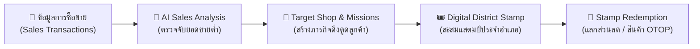

# 📚 ศูนย์รวมข้อกำหนดและโครงสร้างระบบ (Project Standards & Architecture Hub)
### โครงการ ไทยช่วยไทยพลีส (Thai Chuay Thai Please / Kai-Chauy-Roi)
**รายวิชา 02204471-65 Web Application Development | ภาควิชาวิศวกรรมคอมพิวเตอร์ มหาวิทยาลัยเกษตรศาสตร์**

---

## 📌 บทนำและวัตถุประสงค์
เอกสารชุดนี้จัดทำขึ้นเพื่อเป็น **"ข้อกำหนดร่วมกัน (Team Standards & Specifications)"** สำหรับสมาชิกในทีมและผู้ร่วมพัฒนาทุกคน เพื่อให้การทำงานเป็นไปในทิศทางเดียวกัน ทั้งในด้านสถาปัตยกรรมระบบ, โครงสร้าง UI/UX, มาตรฐาน API, โครงสร้างฐานข้อมูล และข้อตกลงในการเขียนโค้ด (Coding Conventions)

---

## 🗺️ แผนผังเอกสารข้อกำหนด (Documentation Map)

เอกสารทั้งหมดถูกแยกออกเป็นรายหมวดหมู่เพื่อให้ง่ายต่อการศึกษาและอ้างอิง ดังนี้:

| ลำดับ | เอกสารข้อกำหนด | รายละเอียด | ลิงก์เอกสาร |
| :---: | :--- | :--- | :---: |
| 1 | **System Architecture** | สถาปัตยกรรมระบบภาพรวม, การแบ่งเลเยอร์ (Layered Architecture), กลไก Core Logic (เงินอุดหนุน 60/40, AI วิเคราะห์ยอดขาย, แสตมป์ดิจิทัล) | [SYSTEM_ARCHITECTURE.md](./SYSTEM_ARCHITECTURE.md) |
| 2 | **UI & Frontend Architecture** | สถาปัตยกรรมหน้าเว็บ, โครงสร้างโฟลเดอร์ React, แผนผัง Sitemap, Design System (สี, ฟอนต์, สเปซิ่ง) และมาตรฐาน UI Components | [UI_STRUCTURE.md](./UI_STRUCTURE.md) |
| 3 | **API Specification** | มาตรฐาน RESTful API, รูปแบบ Response Envelope, รายการ Endpoints สำหรับ Citizen, Merchant, Admin, AI และการจัดการ Auth | [API_SPECIFICATION.md](./API_SPECIFICATION.md) |
| 4 | **Database Structure** | สถาปัตยกรรมฐานข้อมูล, แผนภาพ ER Diagram (13 ตาราง), Data Dictionary ครบทุกฟิลด์, และคู่มือคำสั่ง Prisma ORM | [DATABASE_STRUCTURE.md](./DATABASE_STRUCTURE.md) |
| 5 | **Workflow & Conventions** | ข้อตกลงการพัฒนาในทีม, Git Branching Strategy, Commit Conventions, Naming Standards, และ Pull Request Checklist | [WORKFLOW_CONVENTIONS.md](./WORKFLOW_CONVENTIONS.md) |

---

## 🧩 ภาพรวมระบบ (System Overview)

ระบบ **"ไทยช่วยไทยพลีส"** ถูกออกแบบมาเพื่อส่งเสริมการกระจายรายได้สู่ร้านค้าชุมชน โดยผสาน 4 กลไกหลัก:



### 👥 กลุ่มผู้ใช้งานหลัก (Target Roles)
1. **ประชาชน / ผู้บริโภค (Citizen - `Role: USER`)**: เข้าร่วมภารกิจ, ซื้อสินค้าโดยได้รับเงินอุดหนุนภาครัฐ 60% (ผู้ใช้จ่าย 40%), สะสมแสตมป์ประจำอำเภอ และแลกสิทธิประโยชน์
2. **ร้านค้าชุมชน (Merchant - `Role: MERCHANT`)**: บันทึกการขาย, ตรวจสอบยอดขาย, ได้รับการส่งเสริมผ่านภารกิจเมื่อยอดขายลดลง
3. **ภาครัฐ / ผู้ดูแลระบบ (Government & Admin - `Role: ADMIN`)**: ตรวจสอบผลวิเคราะห์จาก AI, สร้างภารกิจกระตุ้นเศรษฐกิจแบบ Dynamic, จัดการของรางวัล และติดตามผลสัมฤทธิ์เชิงสังคม (Social Impact)

---

## 🛠️ เทคโนโลยีที่ใช้ในระบบ (Technology Stack)

| ส่วนของระบบ | เทคโนโลยีหลัก | เวอร์ชั่น / เครื่องมือประกอบ |
| :--- | :--- | :--- |
| **Frontend** | React 19, TypeScript, Vite | CSS Vanilla, Context API, Lucide Icons |
| **Backend** | Node.js, Express 5, TypeScript | TSX, CORS, Dotenv, Swagger UI |
| **Database & ORM** | MySQL 8.x, Prisma ORM 6.x | Prisma Client, Prisma Studio |
| **Authentication** | Bearer Token Session | Role-based Authorization Guard |
| **API Documentation** | Swagger / OpenAPI 3.0 | `swagger-jsdoc`, `swagger-ui-express` |

---

## 🚀 คู่มือเริ่มต้นสำหรับนักพัฒนา (Developer Quick Start)

### 1. โคลนและเตรียม Repository
```bash
git clone <repository-url>
cd kai-chauy-roi--projectWebapp
```

### 2. ตั้งค่า Backend
```bash
cd backend
npm install
cp .env.example .env   # ตรวจสอบค่า DATABASE_URL ให้ตรงกับเครื่องของคุณ
npx prisma generate    # สร้าง Prisma Client
npm run dev            # เริ่มเซิร์ฟเวอร์ที่ http://localhost:4001
# ดูเอกสาร API Interactive: http://localhost:4001/api-docs
```

### 3. ตั้งค่า Frontend
```bash
cd ../frontnd
npm install
npm run dev            # เริ่ม Vite Dev Server ที่ http://localhost:5173
```

### 4. เปิดดูฐานข้อมูลผ่าน GUI
```bash
cd backend
npx prisma studio      # เปิดหน้าต่างจัดการข้อมูลที่ http://localhost:5555
```

---

## 🛡️ กฎเหล็กประจำทีม (Core Principles)
1. **ความถูกต้องของตรรกะ 60/40**: การบันทึกธุรกรรมการเงินต้องคำนวณสัดส่วนประชาชน 40% และภาครัฐ 60% ให้ถูกต้องตรงกันทั้ง Backend และ Frontend
2. **ห้ามละเมิดสิทธิ์ตาม Role**: ตรวจสอบ Token และ Role ทุกครั้งที่เรียกใช้ Protected Endpoint
3. **อย่า Commit รหัสผ่านหรือข้อมูลลับ**: ห้าม Commit ไฟล์ `.env` ที่มี Credentials จริงลงใน Git เด็ดขาด
4. **ทำตามมาตรฐานเอกสาร**: หากต้องการแก้ไขโครงสร้างใด ๆ ให้เปิด Issue หรือตกลงร่วมกันก่อนแก้ไขเอกสารข้อกำหนด
