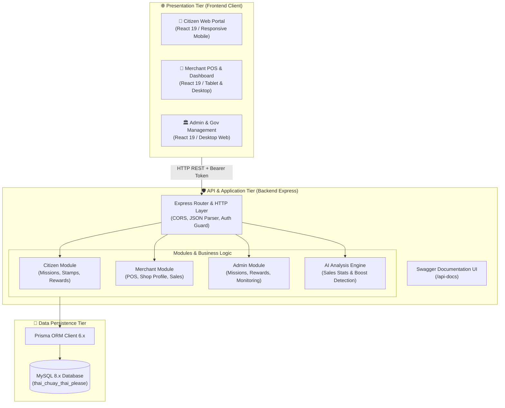
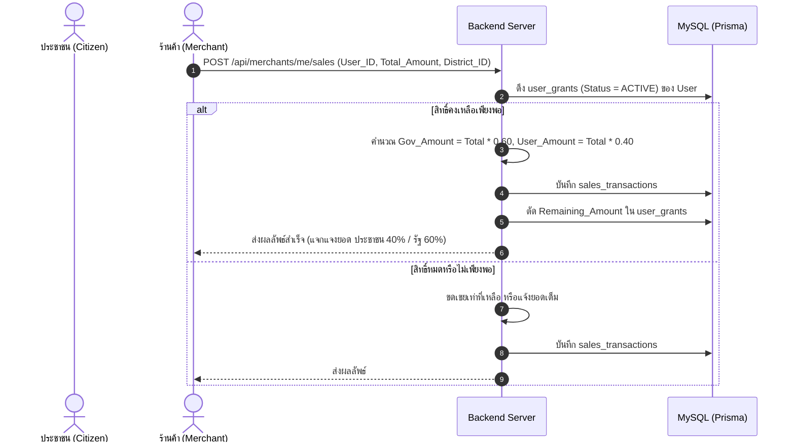
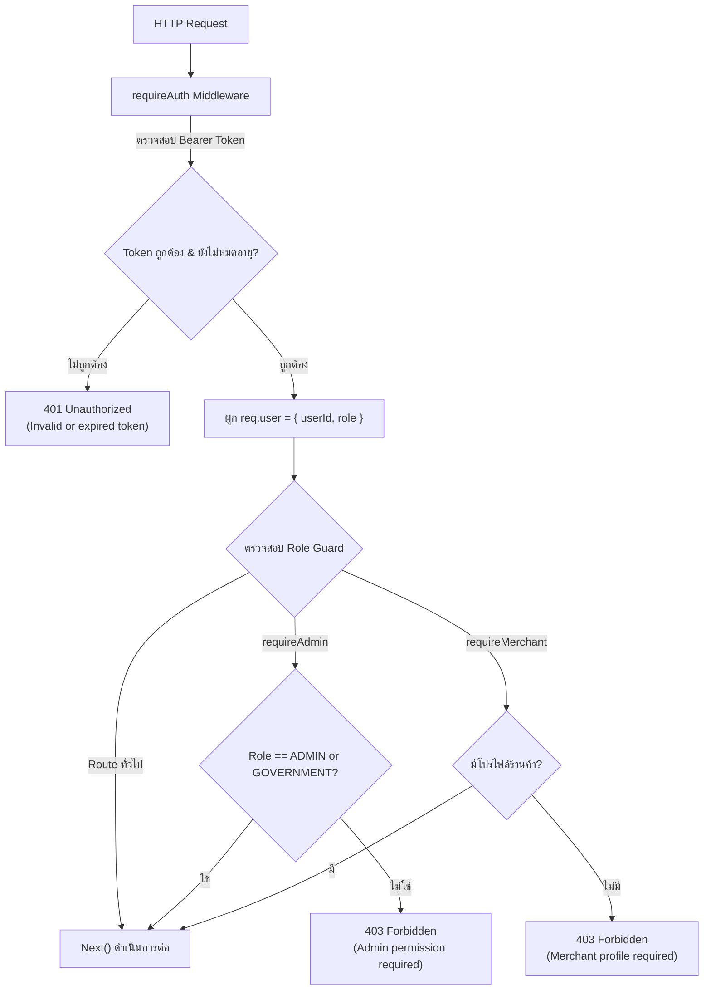

# 🏛️ ข้อกำหนดโครงสร้างและสถาปัตยกรรมระบบ (System Architecture Specification)
### โครงการ ไทยช่วยไทยพลีส (Thai Chuay Thai Please / Kai-Chauy-Roi)

---

## 1. ภาพรวมสถาปัตยกรรมระบบ (Architectural Overview)

ระบบถูกออกแบบตามสถาปัตยกรรม **3-Tier Layered Architecture** ที่แยกส่วนการทำงานออกจากกันอย่างชัดเจน เพื่อความยืดหยุ่น ความปลอดภัย และความง่ายต่อการทดสอบและการขยายตัวในอนาคต



---

## 2. โครงสร้างโฟลเดอร์ฝั่ง Backend (`backend/`)

เพื่อให้ทุกคนเขียนโค้ดไปในทิศทางเดียวกัน สมาชิกในทีมต้องจัดวางไฟล์และเลเยอร์ตามโครงสร้างมาตรฐานนี้:

```text
backend/
├── prisma/
│   ├── schema.prisma        # นิยาม Data Model, Relation และ Generator
│   ├── seed.ts              # สคริปต์ Mock ข้อมูลเบื้องต้น (Provinces, Districts, Admin, Users)
│   └── seed.cjs             # สคริปต์รัน Seed แบบ CommonJS
├── server/
│   ├── index.ts             # Entry point หลัก, กำหนด Middleware, Port และ Mount Routes
│   ├── swagger.ts           # การตั้งค่า OpenAPI 3.0 สเปคและเอกสาร Swagger UI
│   ├── generated/           # ไฟล์ที่สร้างขึ้นอัตโนมัติจาก Prisma Client
│   ├── routes/              # เลเยอร์ Router แยกตามกลุ่มผู้ใช้งาน
│   │   ├── citizen.routes.ts   # เส้นทาง API สำหรับประชาชน (User/Citizen)
│   │   ├── merchant.routes.ts  # เส้นทาง API สำหรับร้านค้าชุมชน (Merchant)
│   │   ├── admin.routes.ts     # เส้นทาง API สำหรับแอดมินและภาครัฐ (Admin/Government)
│   │   └── ai.routes.ts        # เส้นทาง API สำหรับวิเคราะห์ยอดขายและประมวลผล AI
│   └── lib/                 # Core Utilities, Shared Helpers และ Middlewares
│       ├── auth.ts          # ระบบ Session, Token Generation และ Permission Guards
│       ├── http.ts          # Helper ฟังก์ชันสำหรับการตอบกลับ HTTP (sendJson, badRequest ฯลฯ)
│       └── prisma.ts        # Singleton PrismaClient Instance
├── database.sql             # SQL Schema ดั้งเดิมสำหรับ Backup / Reference
├── package.json
└── tsconfig.json
```

---

## 3. กลไกและตรรกะหลักของระบบ (Core Business Logic)

### 3.1 กลไกเงินอุดหนุนภาครัฐ 60/40 (Government Subsidy 60/40 Rule)
ระบบจำลองมาตรการช่วยเหลือค่าครองชีพและกระตุ้นเศรษฐกิจฐานราก:
* **วงเงินตั้งต้น (Initial Grant)**: ผู้ใช้ใหม่ที่ลงทะเบียนจะได้รับวงเงินอุดหนุนเริ่มต้น `1,000.00 บาท` ในตาราง `user_grants`
* **สัดส่วนการชำระ**:
  * **ประชาชนจ่าย (User Paid)**: $40\%$ ของราคาสินค้า (`Total_Amount * 0.40`)
  * **รัฐช่วยจ่าย (Gov Subsidized)**: $60\%$ ของราคาสินค้า (`Total_Amount * 0.60`)
* **เงื่อนไขวงเงินคงเหลือ**:
  * หากสิทธิ์คงเหลือ (`Remaining_Amount`) เพียงพอ: ระบบหักเงินช่วยเหลือจากสิทธิ์คงเหลือตามจำนวน $60\%$
  * หากสิทธิ์คงเหลือมีไม่ถึง $60\%$: ระบบจะอุดหนุนเท่ากับยอดคงเหลือจริงที่เหลืออยู่ และส่วนต่างที่เหลือผู้ใช้ต้องเป็นผู้รับผิดชอบเพิ่มเติม
* **การบันทึกข้อมูล**: รายการชำระเงินทุกครั้งจะถูกบันทึกลงในตาราง `sales_transactions` พร้อมทั้งตัดยอดสิทธิ์ใน `user_grants`



---

### 3.2 กลไก AI วิเคราะห์ยอดขาย (AI Sales Analysis Algorithm)
ระบบประมวลผลยอดขายของร้านค้ารายย่อยเพื่อค้นหาร้านที่ประสบปัญหายอดขายตกต่ำ:
1. **การคำนวณยอดขายรวมและค่าเฉลี่ย**:
   $$\text{Total Sales} = \sum \text{Total\_Amount}$$
   $$\text{Average Sales} = \frac{\text{Total Sales}}{\text{จำนวนบิลทั้งหมดของร้าน}}$$
2. **การเปรียบเทียบกับยอดขายล่าสุด (Sales Ratio)**:
   $$\text{Sales Ratio} = \frac{\text{Latest Sale Amount}}{\text{Average Sales}}$$
3. **เกณฑ์การตรวจจับความผิดปกติ (Low Sales Threshold)**:
   * หาก $\text{Sales Ratio} < 0.80$ (ยอดขายล่าสุดต่ำกว่าค่าเฉลี่ยเกิน $20\%$):
     * กำหนดสถานะ `Sales_Status = "LOW"`
     * กำหนด `Boost_Recommended = true`
   * หากยอดขายปกติ:
     * กำหนด `Sales_Status = "NORMAL"`
     * กำหนด `Boost_Recommended = false`
4. **การนำผลไปใช้งาน**: ข้อมูลจะถูกจัดเก็บลง `ai_sales_analysis` เพื่อส่งต่อไปยัง Admin Dashboard และเป็นข้อมูลในการสร้าง Mission กระตุ้นยอดขายแบบพุ่งเป้า

---

### 3.3 กลไกการสร้างภารกิจทั่วไปและภารกิจเป้าหมาย (Dynamic Missions)
* ผู้ดูแลระบบ (Admin) สามารถดูรายชื่อร้านค้าที่ระบบ AI ชี้เป้าว่าต้องการการส่งเสริม (`/api/ai/target-shops`)
* Admin สามารถสร้าง Mission โดยผูกกับร้านค้าเป้าหมาย (`Target_Merchant_ID`):
  * กำหนดชื่อภารกิจและคำอธิบาย (เช่น *"ซื้อสินค้าจากร้านป้าสมศรี 1 ครั้ง"*)
  * กำหนดจำนวนผู้มีสิทธิ์ได้รับสิทธิ์ (เช่น `10 คนแรก` เพื่อสร้างความเร่งด่วน)
  * กำหนดช่วงเวลาเริ่มต้น (`Start_DateTime`) และสิ้นสุด (`End_DateTime`)

---

### 3.4 กลไกการได้รับแสตมป์ดิจิทัล (Digital Stamp Earning)
ผู้ใช้สามารถได้รับแสตมป์ประจำอำเภอ (`district_stamps`) ผ่าน 2 ช่องทาง:
1. **การซื้อสินค้าตามปกติ**: มียอดซื้อครบ `150 บาทขึ้นไป` ในอำเภอนั้น ๆ
2. **การทำภารกิจสำเร็จ**: เข้าร่วมและทำตามเงื่อนไขของ Mission ที่กำหนด
* แสตมป์ที่ได้รับจะถูกบันทึกไว้ใน `user_stamps` โดยระบุ `Earn_Source` เป็น `PURCHASE` หรือ `MISSION` พร้อมประทับตราเวลา `Earned_At`

---

### 3.5 กลไกการแลกสิทธิประโยชน์ (Stamp Redemption)
* แสตมป์ดิจิทัลแต่ละอำเภอสามารถนำมาแลกรางวัลได้ 2 ประเภท:
  1. **คูปองส่วนลด (Discount)** สำหรับใช้ในการซื้อครั้งถัดไป
  2. **สินค้าของดีประจำจังหวัด / สินค้า OTOP (Community Products)**
* ระบบจะตรวจสอบว่าจำนวนแสตมป์ที่ผู้ใช้ถือครองเพียงพอกับ `Required_Stamp_Count` หรือไม่ ก่อนสร้างเรคคอร์ดใน `stamp_redemptions` ด้วยสถานะ `REQUESTED` / `COMPLETED`

---

## 4. สถาปัตยกรรมความปลอดภัยและการยืนยันตัวตน (Authentication & Security)

ระบบใช้ **Session-based Token ผ่าน Authorization Header** ในรูปแบบ `Bearer <token>`:



### สิทธิ์ของผู้ใช้งาน (Role Matrix):
| สิทธิ์ (Role) | สิทธิ์การเข้าถึง | การตรวจสอบในโค้ด |
| :--- | :--- | :--- |
| **USER / CITIZEN** | ดูภารกิจ, ทำภารกิจ, ดูแสตมป์ตนเอง, แลกของรางวัล, ตรวจสอบวงเงิน | `requireAuth` |
| **MERCHANT** | บันทึกการขาย, ดูข้อมูลร้านตนเอง, แก้ไขพิกัดและประเภทร้าน | `requireMerchant` |
| **ADMIN / GOVERNMENT** | ดูผลวิเคราะห์ AI, จัดการร้านค้า, สร้างภารกิจ, เพิ่มของรางวัล | `requireAdmin` |

---

## 5. มาตรฐานการจัดการข้อผิดพลาด (Error Handling Standard)

ทุก Route ต้องส่ง HTTP Status Code ที่สื่อความหมายชัดเจน และมีโครงสร้างการตอบกลับที่สม่ำเสมอ:

```typescript
// ฟังก์ชันส่งการตอบกลับสำเร็จ
sendJson(res, data, statusCode = 200);

// ฟังก์ชันแจ้งเตือน Client Error (400)
badRequest(res, "ข้อความอธิบายความผิดพลาดของ Input");

// ฟังก์ชันแจ้งเตือน Not Found (404)
notFound(res, "ไม่พบข้อมูลที่ต้องการ");
```
