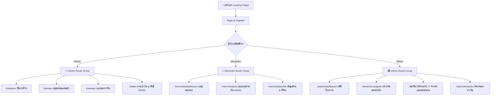

# 🎨 ข้อกำหนดโครงสร้างหน้าจอและมาตรฐาน UI/UX (Frontend & UI Architecture)
### โครงการ ไทยช่วยไทยพลีส (Thai Chuay Thai Please / Kai-Chauy-Roi)

---

## 1. ภาพรวมและเป้าหมายการออกแบบ UI/UX

ส่วนติดต่อผู้ใช้ (User Interface) ของระบบ **"ไทยช่วยไทยพลีส"** ถูกออกแบบเพื่อตอบสนองผู้ใช้งาน 3 กลุ่มหลักที่มีบริบทการใช้งานต่างกัน:
1. **ประชาชน (Citizen)**: เน้นการใช้งานบนสมาร์ทโฟน (**Mobile-First**), เข้าถึงง่าย โหลดไว มีองค์ประกอบ Gamification สนุกสนานในการสะสมแสตมป์
2. **ร้านค้าชุมชน (Merchant)**: ใช้งานผ่านแท็บเล็ตหรือมือถือ ณ จุดขาย (**POS Terminal**), ปุ่มกดขนาดใหญ่ ชัดเจน ไม่ซับซ้อน คำนวณยอด 60/40 อัตโนมัติ
3. **ภาครัฐและผู้ดูแลระบบ (Admin)**: เน้นการใช้งานบนจอ Desktop หรือ Laptop, แสดงผลแดชบอร์ด AI การวิเคราะห์ยอดขาย กราฟ และเครื่องมือจัดการแบบ Data-Rich

---

## 2. โครงสร้างโฟลเดอร์ฝั่ง Frontend (`frontnd/src/`)

เพื่อให้โค้ดของทีมเป็นระเบียบ แบ่งหน้าที่ชัดเจน (Separation of Concerns) ให้จัดโครงสร้างโฟลเดอร์ดังนี้:

```text
frontnd/src/
├── assets/                  # รูปภาพ ไอคอน ฟอนต์ และ Static Assets
│   ├── images/              # รูปภาพประกอบ, โลโก้โครงการ, ตราสัญลักษณ์แสตมป์
│   └── icons/               # SVG ไอคอนเฉพาะของระบบ
├── components/              # Reusable UI Components
│   ├── common/              # คอมโพเนนต์พื้นฐานทั่วไปที่ใช้ร่วมกันทั้งแอป
│   │   ├── Button/          # ปุ่มกด (Primary, Secondary, Danger, Outline)
│   │   ├── Input/           # ฟิลด์กรอกข้อมูล (Text, Password, Number, Search)
│   │   ├── Card/            # กล่อง Card แสดงเนื้อหา
│   │   ├── Modal/           # หน้าต่าง Pop-up แสดงรายละเอียดหรือยืนยัน
│   │   ├── Badge/           # ป้ายสถานะ (Active, Low Sales, Completed)
│   │   ├── Loader/          # ตัวแสดงสถานะระหว่างโหลดข้อมูล
│   │   └── Toast/           # แจ้งเตือนสถานะสำเร็จ/ล้มเหลว (Notifications)
│   └── layout/              # โครงสร้าง Layout หลักของแต่ละ Role
│       ├── Navbar.tsx       # แถบเมนูด้านบน
│       ├── Sidebar.tsx      # เมนูด้านข้างสำหรับ Admin/Merchant
│       ├── BottomNav.tsx    # แถบเมนูด้านล่างสำหรับ Mobile Citizen
│       └── PageContainer.tsx
├── pages/                   # หน้าจอหลักของแอปพลิเคชัน (แบ่งตาม Role)
│   ├── auth/                # หน้าจอด้านการยืนยันตัวตน
│   │   ├── LoginPage.tsx
│   │   └── RegisterPage.tsx
│   ├── citizen/             # หน้าจอฝั่งประชาชน
│   │   ├── MissionFeedPage.tsx      # ฟีดภารกิจและร้านค้าเป้าหมาย
│   │   ├── StampCollectionPage.tsx  # สมุดสะสมแสตมป์ดิจิทัลแต่ละอำเภอ
│   │   ├── RewardStorePage.tsx      # แคตตาล็อกแลกของรางวัล/ส่วนลด OTOP
│   │   ├── WalletPage.tsx           # หน้าตรวจสอบสิทธิ์คงเหลือ 1,000 บาท
│   │   └── TransactionHistoryPage.tsx
│   ├── merchant/            # หน้าจอฝั่งร้านค้า
│   │   ├── MerchantDashboard.tsx    # สรุปยอดขายและสถานะร้าน
│   │   ├── PosCheckoutPage.tsx      # หน้าคิดเงินคำนวณสิทธิ์ 60/40
│   │   └── MerchantProfilePage.tsx  # ตั้งค่าร้านค้าและพิกัดแผนที่
│   └── admin/               # หน้าจอฝั่งผู้ดูแลระบบ/ภาครัฐ
│       ├── AdminDashboard.tsx       # แดชบอร์ดภาพรวมผลกระทบเชิงเศรษฐกิจ
│       ├── AiAnalysisPage.tsx       # แดชบอร์ดวิเคราะห์ยอดขายและชี้เป้าร้านค้า
│       ├── AdminMissionsPanel.tsx  # ประวัติรายวัน 77 จังหวัดและแดชบอร์ดผลยอดขาย
│       └── RewardManagementPage.tsx # จัดการรายการของรางวัลและสต็อก
├── context/                 # React Context สำหรับ Global State
│   ├── AuthContext.tsx      # เก็บสถานะการ Login, Token, User Role
│   └── ToastContext.tsx     # จัดการคิวแจ้งเตือน Toast Alert
├── services/                # เลเยอร์สื่อสารกับ Backend API (HTTP Client)
│   ├── api.ts               # Base Axios/Fetch instance พร้อม Bearer Token Interceptor
│   ├── authService.ts       # ฟังก์ชันเรียก API เกี่ยวกับผู้ใช้และการล็อกอิน
│   ├── citizenService.ts    # ฟังก์ชันเรียก API ภารกิจ แสตมป์ และของรางวัล
│   ├── merchantService.ts   # ฟังก์ชันเรียก API บันทึกการขายและข้อมูลร้าน
│   ├── adminService.ts      # ฟังก์ชันเรียก API สำหรับจัดการระบบ
│   └── aiService.ts         # ฟังก์ชันเรียก API ประมวลผลและดูเป้าหมาย AI
├── types/                   # TypeScript Type & Interface Definitions
│   ├── user.types.ts
│   ├── mission.types.ts
│   ├── stamp.types.ts
│   ├── merchant.types.ts
│   └── api.types.ts
├── styles/                  # Global Styles และ Design Tokens
│   ├── index.css            # CSS Reset, Typography, CSS Variables
│   └── App.css
├── App.tsx                  # การตั้งค่า Route และ Protected Route Wrappers
└── main.tsx                 # Entry Point ของ React DOM
```

---

## 3. แผนผังเส้นทางหน้าจอ (Sitemap & Routing Architecture)



---

## 4. มาตรฐานระบบดีไซน์ (Design System & Aesthetics)

เพื่อให้เว็บแอปพลิเคชันดูทันสมัย พรีเมียม และน่าเชื่อถือตามมาตรฐานกระทรวง/โครงการระดับประเทศ:

### 4.1 จานสีประจำระบบ (Color Palette & Tokens)
ให้ใช้ตัวแปร CSS Variables ใน `index.css`:

```css
:root {
  /* Brand Colors - สื่อถึงความเจริญงอกงามและความเป็นชุมชนไทย */
  --color-primary: #1e40af;          /* น้ำเงินกรมท่าเข้ม สุขุม น่าเชื่อถือ */
  --color-primary-light: #3b82f6;    /* น้ำเงินสว่าง */
  --color-secondary: #059669;        /* เขียวมรกต สื่อถึงเศรษฐกิจยั่งยืน */
  --color-accent: #f59e0b;           /* สีทอง/อำพัน ใช้กับแสตมป์และแต้มสะสม */

  /* Status Colors */
  --color-success: #10b981;          /* สีเขียว สำหรับงานสำเร็จ / Normal sales */
  --color-warning: #f59e0b;          /* สีส้ม สำหรับแจ้งเตือน */
  --color-danger: #ef4444;           /* สีแดง สำหรับ Low Sales / ความผิดพลาด */
  --color-info: #0ea5e9;             /* สีฟ้า สำหรับข่าวสารและไอเดีย */

  /* Neutral Surface & Backgrounds */
  --color-bg-main: #f8fafc;          /* สีพื้นหลังหน้าจอหลัก */
  --color-bg-card: #ffffff;          /* สีพื้นหลังกล่องการ์ด */
  --color-text-main: #0f172a;        /* ข้อความตัวหนังสือหลัก (เกือบดำ) */
  --color-text-muted: #64748b;       /* ข้อความคำอธิบายรอง */
  --color-border: #e2e8f0;          /* สีเส้นขอบ */

  /* Elevation & Shadows */
  --shadow-sm: 0 1px 2px 0 rgb(0 0 0 / 0.05);
  --shadow-md: 0 4px 6px -1px rgb(0 0 0 / 0.1), 0 2px 4px -2px rgb(0 0 0 / 0.1);
  --shadow-lg: 0 10px 15px -3px rgb(0 0 0 / 0.1), 0 4px 6px -4px rgb(0 0 0 / 0.1);

  /* Border Radius */
  --radius-sm: 6px;
  --radius-md: 12px;
  --radius-lg: 16px;
  --radius-full: 9999px;
}
```

### 4.2 ระบบตัวอักษร (Typography)
* **ฟอนต์หลักภาษาไทย**: แนะนำให้ใช้ **`Prompt`** หรือ **`Kanit`** จาก Google Fonts ร่วมกับ **`Inter`** สำหรับภาษาอังกฤษและตัวเลขอารบิก
* **Hierarchy**:
  * Heading 1: `28px - 32px` น้ำหนัก 700 (ตัวหนา)
  * Heading 2: `22px - 24px` น้ำหนัก 600
  * Subheading / Card Title: `16px - 18px` น้ำหนัก 600
  * Body Text: `14px - 16px` น้ำหนัก 400
  * Caption & Meta: `12px` น้ำหนัก 400

### 4.3 จุดตัดขนาดหน้าจอที่รองรับ (Responsive Breakpoints)
* **Mobile (ประชาชน)**: `360px - 480px` (ออกแบบ Layout ให้รองรับนิ้วโป้งเอื้อมถึงง่าย)
* **Tablet (ร้านค้า / POS)**: `768px - 1023px`
* **Desktop (Admin Dashboard)**: `1024px ขึ้นไป`

---

## 5. ข้อกำหนดคอมโพเนนต์สำคัญ (Key Component Specifications)

### 5.1 การ์ดภารกิจ (Mission Card Component)
ต้องประกอบด้วยข้อมูลสำคัญให้ประชาชนเห็นได้ชัดเจน:
* **Badge ประเภทร้านและอำเภอ**: เช่น `[อาหาร/เครื่องดื่ม] เขตพระนคร`
* **ชื่อภารกิจ**: เช่น `แวะชิมกาแฟโบราณร้านลุงสน`
* **โควต้าที่เหลือ (Quota Progress Bar)**: แสดงสัดส่วนผู้ทำสำเร็จ เช่น `เหลืออีก 3 สิทธิ์ จาก 10 คนแรก`
* **แสตมป์ที่จะได้รับ**: แสดงรูปแสตมป์ประจำอำเภอและชื่อรางวัล
* **ปุ่ม Call to Action**: ปุ่ม *"นำทางไปยังร้าน"* หรือ *"ยืนยันทำภารกิจ"*

### 5.2 สมุดสะสมแสตมป์ดิจิทัล (Stamp Passport Grid)
* จัดแสดงในรูปแบบตารางกริด (Grid 3 หรือ 4 คอลัมน์)
* แต่ละช่องแทนแต่ละอำเภอ (`district_stamps`):
  * **สถานะได้รับแล้ว**: ตราประทับสีทอง/สีสันสดใส มีประกาย (Badge Glow) พร้อมแสดงวันที่ได้รับ
  * **สถานะยังไม่ได้รับ**: ตราประทับสีเทาโปร่งแสง (Grayscale Silhouette) พร้อมบอกชื่ออำเภอและจำนวนครั้งที่ต้องซื้อเพื่อปลดล็อก

### 5.3 หน้าจอคิดเงิน POS คำนวณ 60/40 (POS Checkout Breakdown)
หน้าจอสำหรับร้านค้าเมื่อประชาชนมาซื้อของ:
1. **Input**: ช่องกรอกรหัสบัตรประชาชน หรือสแกน QR ผู้ใช้ + ช่องกรอกยอดรวมราคาสินค้า (`Total Amount`)
2. **Real-time Subsidy Calculation Card**:
   * แสดง **ยอดรวมทั้งสิ้น**: `xxx.xx ฿`
   * แสดง **เงินอุดหนุนรัฐ 60%**: `- xx.xx ฿` (แสดงสิทธิ์คงเหลือของผู้ซื้อประกอบ)
   * แสดง **ยอดที่ลูกค้าต้องจ่ายจริง 40%**: `xxx.xx ฿` (ตัวเลขขนาดใหญ่ สีเขียวเด่นชัด)
3. **ปุ่มยืนยันการรับเงิน**: สีเขียวสดใส มี Popup ยืนยันเพื่อป้องกันการกดพลาด

### 5.4 การ์ดวิเคราะห์ AI สำหรับแอดมิน (AI Sales Metric Card)
* แสดงชื่อร้านค้าและอำเภอ
* แสดงอัตราส่วน **Sales Ratio** (เช่น `0.65x ต่ำกว่าค่าเฉลี่ย 35%`)
* สถานะ **Badge**: สีแดงกระพริบ `[LOW SALES - ต้องการกระตุ้น]`
* ภารกิจสร้างจากผลวิเคราะห์รายวันโดยอัตโนมัติ เจ้าหน้าที่เปิดดูผลวิเคราะห์และแก้รายละเอียดได้ ส่วนหน้าประวัติเลือกวันที่จัดเพื่อดูทั้ง 77 จังหวัด พร้อมแดชบอร์ดเปรียบเทียบยอดขายของร้านเดิมกับช่วงอ้างอิง ไม่มีฟอร์มสร้างภารกิจเอง

---

## 6. มาตรฐานการจัดการ State และการเชื่อมต่อ API

1. **Token Storage**: เก็บ Session Bearer Token ไว้ใน `localStorage` หรือ `sessionStorage` ภายใต้คีย์ `"kai_chuay_token"`
2. **Axios/Fetch Wrapper**: ทุกคำขอที่เป็น Authenticated Request ต้องแนบ Header:
   ```text
   Authorization: Bearer <token>
   Content-Type: application/json
   ```
3. **Empty States**: เมื่อไม่มีข้อมูล (เช่น ยังไม่มีแสตมป์ หรือไม่มีภารกิจ) ต้องมีภาพ Illustration และข้อความอธิบายเป็นมิตร ห้ามปล่อยเป็นหน้าจอว่างเปล่า
4. **Loading States**: แสดง Skeleton Loader หรือ Spinner ที่นุ่มนวลทุกครั้งที่กำลังรอการตอบกลับจาก API
