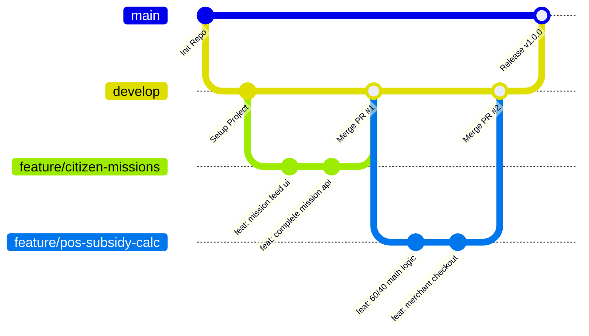

# 🤝 ข้อตกลงการพัฒนาและการทำงานร่วมกันในทีม (Workflow & Conventions)
### โครงการ ไทยช่วยไทยพลีส (Thai Chuay Thai Please / Kai-Chauy-Roi)

---

## 1. กลยุทธ์การบริหารกิ่ง Git (Git Branching Strategy)

เพื่อให้สมาชิกในทีมสามารถพัฒนาฟีเจอร์ต่าง ๆ ควบคู่กันไปได้โดยไม่เกิดข้อขัดแย้งของโค้ด (Merge Conflict) เราใช้แนวทาง **GitHub Flow / Feature Branch Workflow**:

### รายละเอียดประเภทของ Branch:
* **`main`**: กิ่งหลักสำหรับ Production เท่านั้น โค้ดบนนี้ต้องผ่านการทดสอบและทำงานได้ 100% เสมอ
* **`develop`**: กิ่งหลักสำหรับการพัฒนาและรวมโค้ด (Integration Branch) สมาชิกทุกคนจะเปิด Pull Request เข้ากิ่งนี้
* **`feature/<ชื่อฟีเจอร์>`**: กิ่งสำหรับพัฒนาฟีเจอร์ใหม่ เช่น:
  * `feature/auth-login`
  * `feature/merchant-pos`
  * `feature/ai-analysis-page`
* **`bugfix/<ชื่อบั๊ก>`**: กิ่งสำหรับแก้ไขข้อผิดพลาด เช่น:
  * `bugfix/fix-token-expiration`
  * `bugfix/fix-subsidy-rounding`
* **`docs/<ชื่อเอกสาร>`**: กิ่งสำหรับการปรับปรุงเอกสาร เช่น `docs/update-api-spec`

---

## 2. มาตรฐานข้อความ Commit (Conventional Commits)

ทุกการ Commit ต้องขึ้นต้นด้วยประเภทของงาน (Prefix) ตามมาตรฐานสากล:

| Prefix | การนำไปใช้ | ตัวอย่างข้อความ |
| :--- | :--- | :--- |
| **`feat:`** | เพิ่มฟีเจอร์ใหม่ | `feat: add 60/40 subsidy calculation on sales endpoint` |
| **`fix:`** | แก้ไขบั๊กหรือข้อผิดพลาด | `fix: handle null province in user registration` |
| **`docs:`** | ปรับปรุงเอกสาร README หรือคู่มือ | `docs: add UI structure specification markdown` |
| **`style:`** | ปรับปรุงความสวยงาม CSS หรือจัด Format โดยไม่กระทบ Logic | `style: improve stamp card hover animation and colors` |
| **`refactor:`** | ปรับปรุงโครงสร้างโค้ดโดยที่การทำงานภายนอกยังเหมือนเดิม | `refactor: extract session verification into auth middleware` |
| **`test:`** | เพิ่มหรือปรับปรุง Unit Test / E2E Test | `test: add unit test for AI sales ratio threshold` |
| **`chore:`** | งานทั่วไป เช่น อัปเดต npm packages หรือ config | `chore: update prisma to version 6.19.3` |

---

## 3. กฎการตั้งชื่อและมาตรฐานการเขียนโค้ด (Naming Conventions)

### 3.1 ภาษา TypeScript และ React
* **ไฟล์ Component / Page**: ใช้ **`PascalCase.tsx`**
  * *ตัวอย่าง*: `MissionCard.tsx`, `PosCheckoutPage.tsx`, `AdminDashboard.tsx`
* **ไฟล์ Utility / Service / Helper**: ใช้ **`camelCase.ts`**
  * *ตัวอย่าง*: `authService.ts`, `citizenService.ts`, `formatCurrency.ts`
* **ชื่อ Class และ Interface / Type**: ใช้ **`PascalCase`**
  * *ตัวอย่าง*: `interface UserProfile`, `type MissionStatus`, `interface SaleTransaction`
* **ชื่อฟังก์ชันและตัวแปร**: ใช้ **`camelCase`**
  * *ตัวอย่าง*: `calculateSubsidy()`, `handleCompleteMission()`, `remainingAmount`
* **ค่าคงที่ (Constants)**: ใช้ **`UPPER_SNAKE_CASE`**
  * *ตัวอย่าง*: `const DEFAULT_GRANT_AMOUNT = 1000;`, `const GOV_RATIO = 0.60;`

### 3.2 ฝั่ง Backend และฐานข้อมูล
* **ไฟล์ Route**: ใช้รูปแบบ **`<module>.routes.ts`**
  * *ตัวอย่าง*: `citizen.routes.ts`, `merchant.routes.ts`, `ai.routes.ts`
* **ชื่อ Table ใน Database**: ใช้ตัวพิมพ์เล็กแบบ **`snake_case`**
  * *ตัวอย่าง*: `sales_transactions`, `user_stamps`, `district_stamps`
* **ชื่อ Column ใน Database**: ใช้ตาม Schema ดั้งเดิมของระบบเพื่อความเข้ากันได้
  * *ตัวอย่าง*: `User_ID`, `Total_Amount`, `Gov_Subsidized_Amount`

---

## 4. การจัดการตัวแปรสภาพแวดล้อมและความปลอดภัย (Environment & Security)

1. **ห้าม Commit `.env` ลงใน Git เด็ดขาด**:
   * ตรวจสอบให้แน่ใจว่าไฟล์ `.env` ถูกระบุไว้ใน `.gitignore` เรียบร้อยแล้ว
2. **รักษา `.env.example` ให้ตรงกับความจริงเสมอ**:
   * เมื่อใดก็ตามที่มีการเพิ่ม Environment Variable ตัวใหม่ ให้บันทึกชื่อตัวแปรพร้อมค่าตัวอย่างลงใน `.env.example` เสมอ
3. **การเก็บรักษารหัสผ่าน**:
   * ในระบบจริง ห้ามเก็บ Plaintext Password ต้องทำการ Hash ด้วย Bcrypt ก่อนบันทึกลงในฟิลด์ `Password`
4. **การตรวจสอบสิทธิ์ใน API**:
   * ทุก Endpoint ที่เกี่ยวข้องกับเงิน วงเงินอุดหนุน หรือการแก้ไขข้อมูล ต้องผ่าน Middleware `requireAuth`, `requireMerchant` หรือ `requireAdmin` ห้ามละเลย

---

## 5. กระบวนการตรวจสอบโค้ด (Pull Request & Code Review Checklist)

ก่อนจะทำการ Merge โค้ดเข้าสู่กิ่ง `develop` ผู้พัฒนาและผู้ Review ต้องตรวจสอบตาม Checklist นี้:

- [ ] **Build & Lint ผ่านฉลุย**: โค้ดสามารถรัน `npm run build` หรือ `tsc --noEmit` ได้โดยไม่มี Error
- [ ] **ไม่มี Console.log ขยะ**: ลบ `console.log` ที่ใช้ทดสอบชั่วคราวออกทั้งหมด
- [ ] **การคำนวณถูกต้อง**: ตรวจสอบว่าตรรกะคำนวณเงิน 60/40 หรือการตัดแต้มแสตมป์ถูกต้อง ไม่ติดลบ
- [ ] **จัดการ Loading & Error State ครบถ้วน**: หน้าจอฝั่ง Frontend มีตัวหมุนตอนโหลด และมีข้อความแจ้งเตือนเมื่อเกิด Error
- [ ] **Responsive Design**: ทดสอบแสดงผลบนหน้าจอทั้งแบบมือถือ (Mobile) และจอคอมพิวเตอร์ (Desktop)
- [ ] **อัปเดตเอกสาร**: หากมีการเพิ่มหรือเปลี่ยนแปลง API ให้แก้ไขใน [`API_SPECIFICATION.md`](./API_SPECIFICATION.md) หรือ Swagger เสมอ
